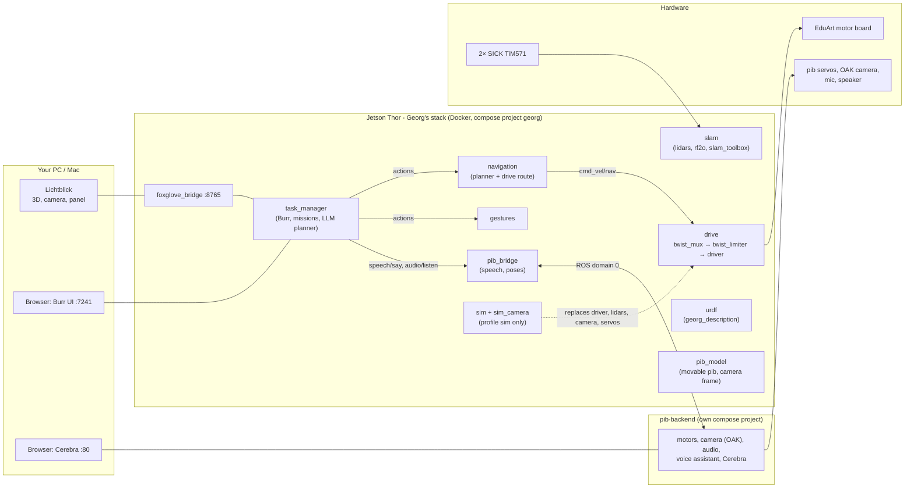
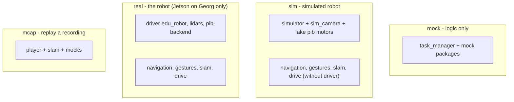
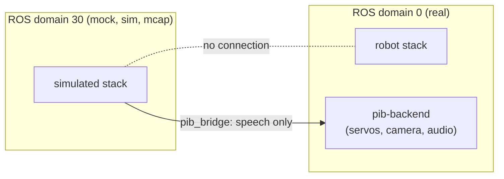
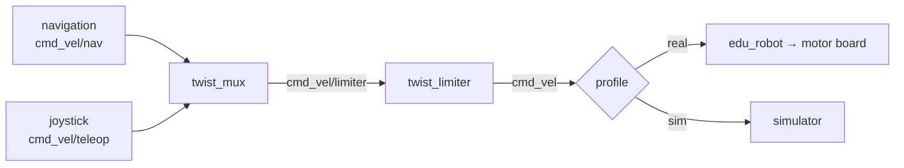
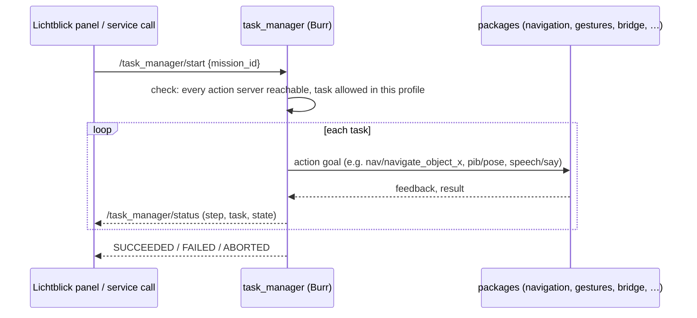

# Georg at home

Software for **Georg**, the AutonOhm service robot: a mecanum base with two lidars carrying a
[pib](https://pib.rocks) humanoid upper body. Everything runs in Docker containers on the
**Jetson Thor**; the pib upper body is driven by [pib-backend](https://github.com/pib-rocks/pib-backend).

- One command starts the whole robot, a simulation, a test stack or a replay:
  `./projectctl.bash up mock|sim|real|mcap`
- A **task manager** (Burr state machine) runs missions made of tasks (drive, gesture, speak,
  listen …); optionally an LLM plans them.
- **Lichtblick** shows everything: robot model, lidar, map, head camera, mission status.

More: [docs/OPERATIONS.md](docs/OPERATIONS.md) (setup, start, test),
[docs/DECISIONS.md](docs/DECISIONS.md) (why it is built this way),
[docs/OPEN_ISSUES.md](docs/OPEN_ISSUES.md) (what is open, who owns it).

## At a glance



## Packages

Every package is one container (`packages/pkg_<name>/` with `Dockerfile`, `docker-compose.yaml`,
`config/` mounted at runtime). Interfaces shared between containers live in `pkg_interfaces` and
are built into the base image.

| Package | What it does | Owner |
| --- | --- | --- |
| `docker_base_image` | ROS 2 Jazzy base: all interfaces of `pkg_interfaces` + pib-backend's `datatypes` | stack |
| `pkg_interfaces` | Messages/actions: `georg_nav_msgs`, `georg_gesture_msgs` (incl. `PibPose`), `georg_speech_msgs` (`Listen`, `Say`), `georg_sim_msgs`, `georg_task_manager_msgs` | stack |
| `pkg_task_manager` | Missions and tasks on Burr, services `/task_manager/*`, mock packages, MCAP recorder, Burr UI | task manager team |
| `pkg_navigation` | A* planner on the map YAML + route driver (to be replaced by Nav2) | navigation team |
| `pkg_drive` | EduArt driver, joystick, `twist_mux`, `twist_limiter` | drive (Sam) |
| `pkg_slam` | Lidar drivers, scan merger, rf2o odometry, slam_toolbox; **maps** in `maps/` | SLAM (Sam) |
| `pkg_urdf` | Georg's robot description (`georg_description`) | Sam |
| `pkg_gestures` | Gesture action server (look at, point, greet) | gesture team |
| `pkg_pib_model` | Movable pib on Georg for Lichtblick, joint conversion, head camera frame, fake motors + named poses in sim | stack |
| `pkg_pib_bridge` | Bridge to pib-backend: speak, listen (two ROS domains, fixed allowlist) | stack |
| `pkg_sim` | 2D / MuJoCo simulator, simulated lidars and head camera, world generators | stack |
| `pkg_viz` | `foxglove_bridge` for Lichtblick, Lichtblick panel and layout, RViz (profile `viz`) | stack / Sam |
| `pkg_llm` | Local LLM server for the planner (optional) | stack |
| `pkg_examples` | Templates for actions/topics (profile `examples`) | Sam |
| `pkg_object_detection` | Dataset and model for the OAK camera (no container) | object detection team |

## Profiles: what runs where



| Service | mock | sim | real | mcap |
| --- | :-: | :-: | :-: | :-: |
| task_manager, foxglove_bridge, recorder, burr_ui | ✓ | ✓ | ✓ | ✓ |
| mock_packages (fake action servers) | ✓ | | | ✓ |
| sim, sim_camera | | ✓ | | |
| navigation, gestures, drive | | ✓ | ✓ | |
| slam, urdf, pib_model | | ✓ | ✓ | ✓ |
| player | | | | ✓ |
| pib_bridge (`GEORG_WITH_PIB_BACKEND=1`) | | ✓ | ✓ | |

`drive` runs the motor driver **only** in `real`; in `sim` it runs `twist_mux` and
`twist_limiter` only (Sam's `sim_mode`), so the simulated robot gets exactly the robot's command
chain.

## Safety: sim can never move the robot



- `projectctl.bash` sets `ROS_DOMAIN_ID`: **0 for `real`**, 30 for everything else. Nodes in
  different domains cannot see each other.
- `up real` is refused unless `/etc/georg/mode` says `real` and the hardware scan
  (`tools/hardware_scan.py`) finds no problem.
- In `sim` the driver is not started; the sim's head camera is rendered, never the real one.
- `pib_bridge` passes only speech between the domains – no motor commands, no sensor data.

## Driving



## A mission



Missions live in `pkg_task_manager/.../missions/`, the allowed tasks in
`catalog/catalog.yaml`. Examples: `sim_seat`, `sim_gestures`, `arena_tour`, `greeting`,
`sim_reset`.

## Quick start

```bash
./projectctl.bash build                     # all images (first time: long)
./projectctl.bash up sim                    # simulation (GEORG_MAP=Arena.yaml for the apartment)
./projectctl.bash status                    # containers and health
tests/stack/run.sh sim                      # acceptance checks against the running stack
./projectctl.bash down
```

Lichtblick 1.30: connection *Foxglove WebSocket* `ws://<jetson>:8765`, layout
`packages/pkg_viz/lichtblick_layouts/georg_sim.json`, panel
`packages/pkg_viz/lichtblick_panel` (`python3 build.py`, install the `.foxe`). Details and all
switches: [docs/OPERATIONS.md](docs/OPERATIONS.md).

## Network

Subnet `192.168.2.0/24` with DNS (`ping jetson`, `ping jetson.georg.net`).

| Range | Use | Type |
| --- | --- | --- |
| .1 – .20 | physical hardware (.1 `raspi`, .2 `jetson`, .20 `edu-motor-board`) | static |
| .21 – .50 | containers on the pib | static |
| .51 – .80 | containers on the Jetson | static |
| .100 – .255 | external devices (laptops) | DHCP |

<details><summary>All addresses</summary>

| IP   | DNS                | Use                                                     |
|------|--------------------|----------------------------------------------------------------|
| ".1  | raspi              | Raspi on the pib                                              |
| ".2  | jetson             | Jetson thor                                                    |
| ".20 | edu-motor-board    | EduArt Ethernet→CAN motor controller adapter                    |
| ".21 | pib-rosbridge      | rosbridge container on the pib                          |
| ".22 | pib-flask          | Flask API container on the pib                                     |
| ".23 | pib-blockly        | Blockly server (block programming) container on the pib |
| ".24 | pib-camera         | Luxonis Kamera Node container on the pib                           |
| ".25 | pib-motors         | Servomotor Steuerung Node container on the pib                     |
| ".26 | pib-webots         | Webots Simulator container on the pib                              |
| ".27 | pib-voiceassistant | Voice assistant container on the pib                               |
| ".28 | pib-ros-programs   | Cerebra programs container on the pib                             |
| ".29 | pib-display        | Display container on the pib                                       |
| ".30 | pib-audio-io       | Audio I/O container on the pib                                     |
| ".40 | pib-cerebra        | Cerebra web server container on the pib                             |


</details>
