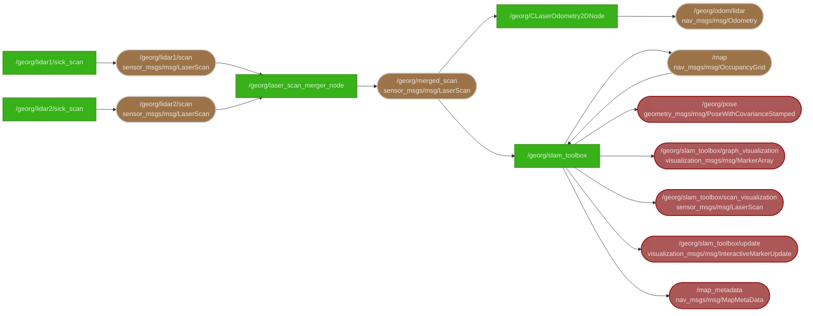

# slam

Simultaneous localisaton and mapping + lidar interface

Nodes:
- [slam_toolbox](https://github.com/SteveMacenski/slam_toolbox) - SLAM implementation
- [rf2o_laser_odometry](https://github.com/MAPIRlab/rf2o_laser_odometry) - LiDAR odometrie
- [sick_scan_xd](https://github.com/SICKAG/sick_scan_xd/tree/3.8.0) - Daten aus LiDAR holen (unsere TIM571 verlieren support nach v3.8.0)
- [laser_scan_merger](https://github.com/BruceChanJianLe/laser_scan_merger.git) - 2 laser scans zu einem mergen

> [!TIP]
> Visualize slam with `rviz2 -d georg_slam.rviz`
